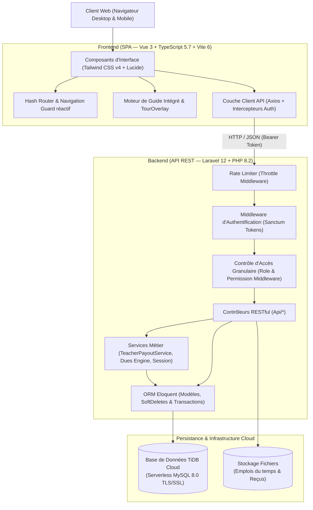
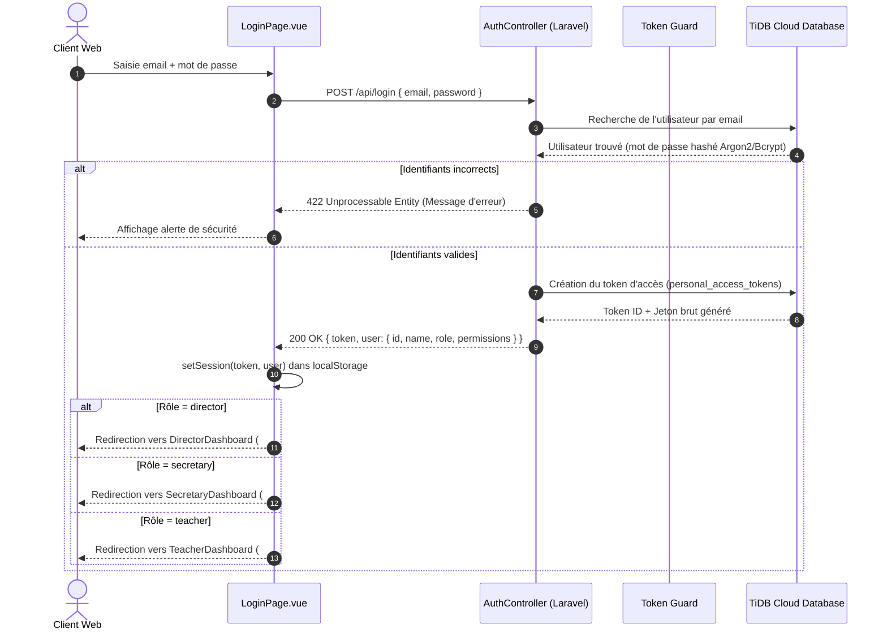
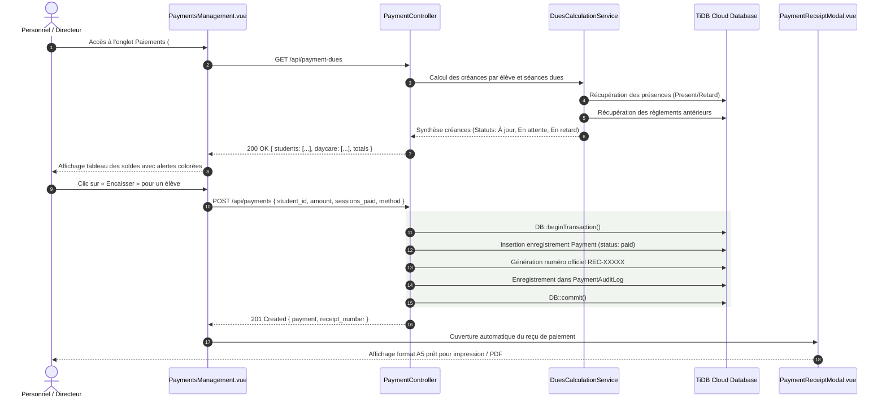
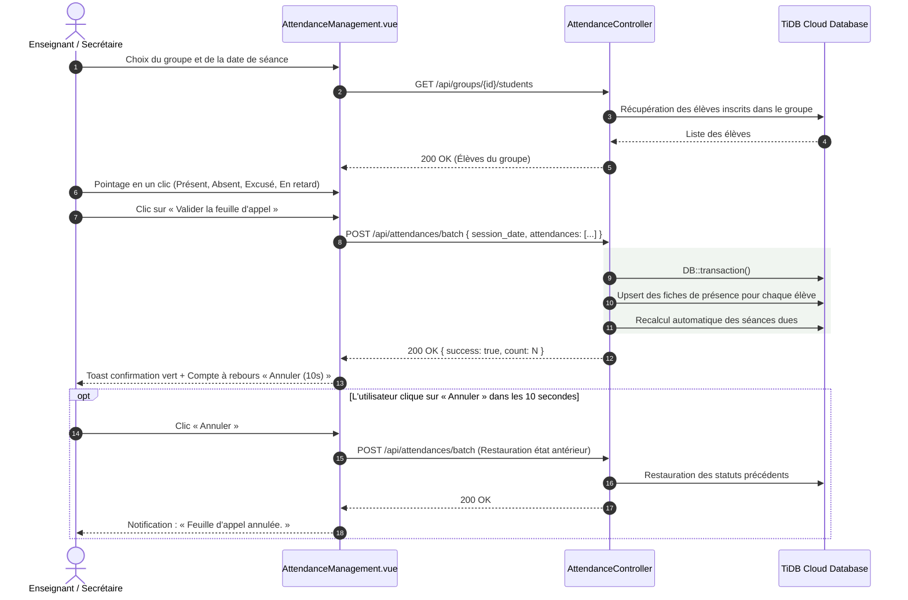
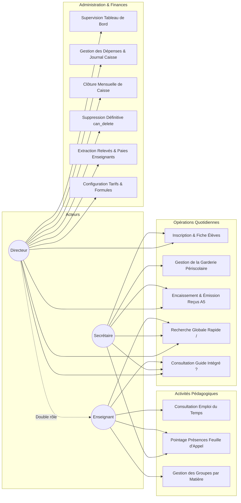

# Architecture Complète du Système — Centre d'Études & Garderie

> **Document de Référence Technique & Modélisation UML**  
> **Application** : Study Center Management System  
> **Version** : 2.0.0 (Production Ready)  
> **Dernière mise à jour** : 13 Novembre 2026  
> **Conformité** : Standards PFE & Architectures Logicielle Modernes

---

## 1. Vue d'Ensemble de l'Architecture Système

L'application repose sur un modèle d'architecture **client-serveur découplé** (Single Page Application + API REST Stateless), sécurisé par jetons d'accès révocables (Laravel Sanctum) et déployé sur une infrastructure cloud conteneurisée.

---

## 2. Modélisation Métier — Diagramme de Classes UML (@uml-architect)

Ce diagramme de classes Mermaid modélise l'intégralité des entités de la couche domaine, leurs attributs typés, leurs méthodes métiers ainsi que leurs cardinalités exactes.

```mermaid
classDiagram
    direction TB

    class User {
        +BigInt id
        +String name
        +String email
        +String password
        +String role
        +String phone
        +Boolean is_active
        +Array permissions
        +Timestamp created_at
        +Timestamp updated_at
        +teacher() Teacher
        +guideProgress() UserGuideProgress
        +activityLogs() ActivityLog
        +hasPermission(key) Boolean
        +isDirector() Boolean
    }

    class Teacher {
        +BigInt id
        +BigInt user_id
        +String name
        +String email
        +String phone
        +String subject
        +Integer weekly_lessons
        +Decimal salary_per_lesson
        +Decimal fixed_student_rate
        +Decimal center_fixed_per_student
        +String remuneration_type
        +Decimal rate_percentage
        +String payout_status
        +Date payout_date
        +String payout_by
        +Timestamp deleted_at
        +user() User
        +subjects() Subject
        +groups() Group
        +students() Student
        +attendances() Attendance
        +payments() Payment
        +calculateMonthlyShare(gross) Decimal
    }

    class Student {
        +BigInt id
        +String name
        +String level
        +String group_name
        +String phone
        +String parent_phone
        +String status
        +Boolean is_remise
        +Decimal remise
        +String discount_type
        +Decimal base_fee
        +Timestamp deleted_at
        +groups() Group
        +subjects() Subject
        +attendances() Attendance
        +payments() Payment
        +calculateNetFee() Decimal
    }

    class Group {
        +BigInt id
        +String name
        +String level
        +String subject
        +BigInt teacher_id
        +Timestamp created_at
        +teacher() Teacher
        +students() Student
        +scheduleItems() ScheduleItem
    }

    class Subject {
        +BigInt id
        +String name
        +String slug
        +teachers() Teacher
        +students() Student
    }

    class DaycareChild {
        +BigInt id
        +String name
        +Integer age
        +String parent_name
        +String phone
        +String schedule
        +Decimal monthly_fee
        +String status
        +Date start_date
        +Timestamp deleted_at
        +payments() Payment
    }

    class Attendance {
        +BigInt id
        +BigInt student_id
        +BigInt teacher_id
        +Date session_date
        +String status
        +String group_name
        +String subject_name
        +Decimal price_per_session
        +Text notes
        +student() Student
        +teacher() Teacher
    }

    class Payment {
        +BigInt id
        +BigInt student_id
        +BigInt teacher_id
        +BigInt daycare_child_id
        +String student_name
        +String month
        +Decimal amount
        +Date date
        +String status
        +Integer sessions_paid
        +Integer months_paid
        +String payment_method
        +String receipt_number
        +Timestamp deleted_at
        +student() Student
        +teacher() Teacher
        +daycareChild() DaycareChild
        +auditLogs() PaymentAuditLog
    }

    class ScheduleItem {
        +BigInt id
        +BigInt teacher_id
        +BigInt group_id
        +BigInt room_id
        +Integer day_of_week
        +Time start_time
        +Time end_time
        +String subject
        +String group_name
        +teacher() Teacher
        +room() Room
        +group() Group
    }

    class Room {
        +BigInt id
        +String name
        +Integer capacity
        +scheduleItems() ScheduleItem
    }

    class School {
        +BigInt id
        +String name
        +String city
        +String address
        +classes() SchoolClass
        +imports() SchoolCalendarImport
    }

    class SchoolClass {
        +BigInt id
        +BigInt school_id
        +String name
        +String grade_level
        +school() School
        +imports() SchoolCalendarImport
    }

    class SchoolCalendarImport {
        +BigInt id
        +BigInt school_id
        +BigInt school_class_id
        +String title
        +String file_path
        +String file_type
        +school() School
        +schoolClass() SchoolClass
    }

    class Expense {
        +BigInt id
        +String title
        +String category
        +Decimal amount
        +Date expense_date
        +Boolean is_recurring
        +String frequency
        +BigInt created_by
    }

    class MonthlyClosing {
        +BigInt id
        +String month
        +Decimal total_revenue
        +Decimal total_teacher_payouts
        +Decimal total_expenses
        +Decimal net_profit
        +Timestamp closed_at
        +BigInt closed_by
        +String status
    }

    class UserGuideProgress {
        +BigInt id
        +BigInt user_id
        +String key
        +Timestamp completed_at
        +user() User
    }

    class ActivityLog {
        +BigInt id
        +BigInt user_id
        +String module
        +String action
        +String description
        +Array metadata
        +String ip_address
        +Timestamp created_at
        +user() User
    }

    %% Relations et Cardinalités
    User "1" -- "0..1" Teacher : est associé à
    User "1" -- "*" UserGuideProgress : suit
    User "1" -- "*" ActivityLog : génère

    Teacher "1" -- "*" Group : anime
    Teacher "1" -- "*" Attendance : valide
    Teacher "1" -- "*" Payment : perçoit
    Teacher "1" -- "*" ScheduleItem : planifie
    Teacher "*" -- "*" Subject : enseigne

    Student "*" -- "*" Group : participe
    Student "*" -- "*" Subject : suit
    Student "1" -- "*" Attendance : enregistre
    Student "1" -- "*" Payment : règle

    DaycareChild "1" -- "*" Payment : justifie
    Room "1" -- "*" ScheduleItem : accueille
    School "1" -- "*" SchoolClass : regroupe
    School "1" -- "*" SchoolCalendarImport : possède
    SchoolClass "1" -- "*" SchoolCalendarImport : associe
```

---

## 3. Diagrammes de Séquence Métier (@uml-architect)

### 3.1 Authentification Sanctum & Contrôle d'Accès RBAC

---

### 3.2 Moteur de Créances & Encaissement avec Reçu Officiel A5

---

### 3.3 Pointage des Présences en Lot & Fenêtre d'Annulation (Undo 10s)

---

## 4. Diagramme de Cas d'Utilisation UML (@uml-architect)

---

## 5. Moteur Financier & Règles de Rémunération

Le système intègre trois formules de rémunération enseignante paramétrables par la Direction :

1. **Formule C — Pourcentage sur C.A. Brut (`percentage`)** :
   $$\text{Part Professeur} = (\text{Prix séance} \times \text{Séances/mois} \times \text{Élèves}) \times \frac{\text{Taux \%}}{100}$$
   *Exemple :* Cours à 25 TND / séance (100 TND / mois), taux à 70% ➔ 70 TND pour le professeur, 30 TND de marge centre par élève.

2. **Formule A — Part Fixe Administration (`fixed_center`)** :
   $$\text{Part Centre} = \text{Montant fixe administration} \times \text{Élèves}$$
   $$\text{Part Professeur} = \text{C.A. Brut} - \text{Part Centre}$$

3. **Formule B — Montant Fixe par Élève (`fixed_student_rate`)** :
   $$\text{Part Professeur} = \text{Montant fixe par élève} \times \text{Élèves}$$
   Le centre conserve l'intégralité du reliquat après déduction de la part fixe.

> **Règle de Protection Enseignante (Absorption des Remises)** :  
> Toute remise tarifaire accordée à une famille d'élèves (fratrie, besoin social) est **absorbée à 100% par l'administration**. Les honoraires des professeurs restent calculés sur le plein tarif brut contractuel.

---

## 6. Déploiement Cloud & Sécurité de Production

- **Backend** : Conteneurisé via Docker (`backend/Dockerfile`, Alpine Linux PHP 8.2-cli) et orchestré sur Render Web Service.
- **Base de Données** : TiDB Cloud Serverless (MySQL 8.0) situé dans la région Francfort (`gateway01.eu-central-1.prod.aws.tidbcloud.com:4000`), avec vérification de certificat CA système (`/etc/ssl/certs/ca-certificates.crt`).
- **Frontend** : Site statique distribué à haute disponibilité avec réécriture SPA (`/* ➔ /index.html`).
- **Sécurité des Sessions** : Double seuil d'expiration (1 heure en cas de fermeture du navigateur, 2 heures continues d'inactivité).
