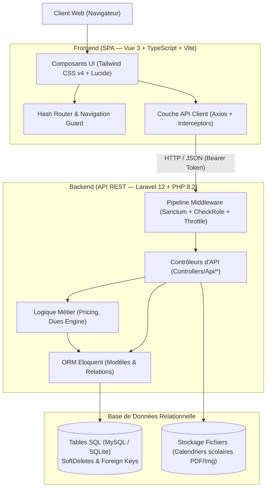
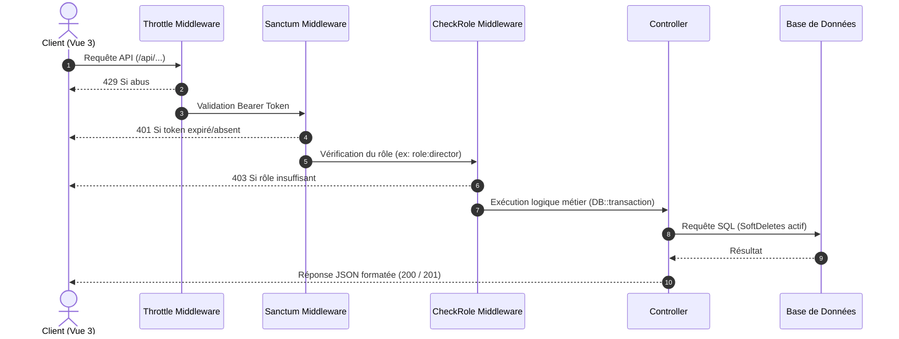
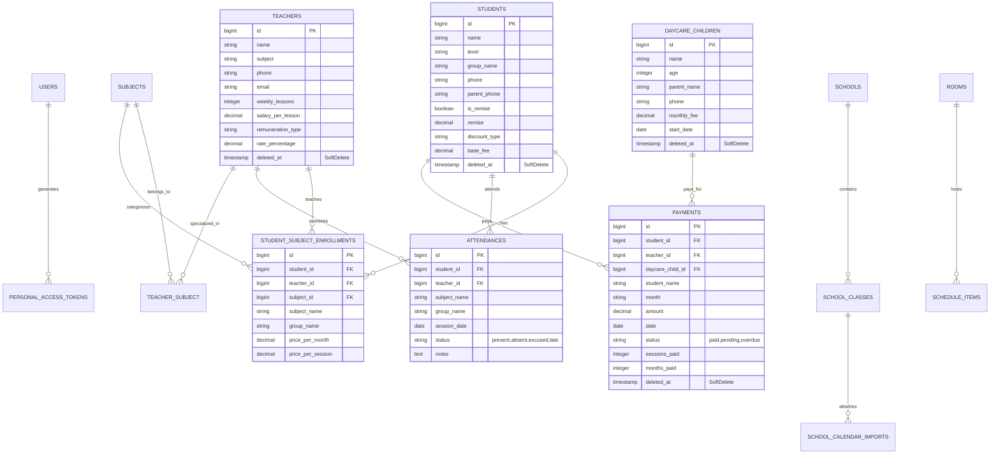

# Architecture Complète du Système — Centre d'Études

> **Document de Référence Technique & Fonctionnelle**  
> **Application** : Web app design for study center  
> **Version** : 1.2.0  
> **Dernière mise à jour** : 05 Octobre 2026  

---

## 1. Vue d'Ensemble de l'Architecture (High-Level)

L'application est construite selon une architecture **client-serveur découplée (SPA + API REST)**, garantissant une séparation nette entre l'interface utilisateur et la logique métier.



---

## 2. Architecture Frontend (SPA)

### 2.1 Stack Technique
* **Framework** : [Vue 3](https://vuejs.org/) (avec `<script setup lang="ts">` et Composition API).
* **Typage** : [TypeScript](https://www.typescriptlang.org/) strict (`vue-tsc`).
* **Bundler & Serveur de dev** : [Vite](https://vitejs.dev/) avec proxy HTTP `/api` vers le backend local `http://127.0.0.1:8000`.
* **Styling** : [Tailwind CSS v4](https://tailwindcss.com/) avec `@tailwindcss/vite`.
* **Icônes** : `lucide-vue-next`.
* **Client HTTP** : `axios` avec intercepteur centralisé pour le Bearer Token et la gestion du code 401.

### 2.2 Arborescence des Composants
```
src/
├── app/
│   ├── App.vue                   # Composant racine (Auth gate: Login vs Dashboards)
│   ├── components/               # Écrans et modules fonctionnels
│   │   ├── LoginPage.vue         # Authentification standard et connexion rapide locale
│   │   ├── DirectorDashboard.vue # Shell Directeur avec onglets et header
│   │   ├── SecretaryDashboard.vue# Shell Secrétaire (droits restreints)
│   │   ├── DashboardOverview.vue # Statistiques globales, graphiques et flux d'activités
│   │   ├── StudentsManagement.vue# CRUD élèves, gestion des matières et remises
│   │   ├── AttendanceManagement.vue# Pointage des présences par lot (Batch attendance)
│   │   ├── PaymentsManagement.vue# Soldes dus, encaissement et impression de reçus
│   │   ├── DaycareManagement.vue # Gestion des enfants inscrits en garderie
│   │   ├── TeachersManagement.vue# Gestion des enseignants et rémunérations
│   │   ├── ScheduleManagement.vue# Emploi du temps par salle et par créneau
│   │   ├── SchoolCalendar.vue    # Import et visualisation des calendriers scolaires
│   │   └── FinancialReports.vue  # Rapports financiers & comptabilité (Directeur)
│   ├── router/
│   │   └── index.ts              # Déclaration des routes canoniques
│   └── utils/
│       └── api.ts                # Instance Axios configurée (Auth interceptors)
├── styles/
│   └── index.css                 # Configuration Tailwind et variables de style
└── main.ts                       # Point d'entrée, initialisation de Pinia et Router
```

### 2.3 Cycle de Vie et Navigation (Hash Routing Synchronisé)
Les tableaux de bord (`DirectorDashboard.vue` et `SecretaryDashboard.vue`) maintiennent l'onglet actif synchronisé avec le `window.location.hash` :
* `#dashboard` ➔ Tableau de bord
* `#students` ➔ Gestion des élèves
* `#attendance` ➔ Présences & Groupes
* `#payments` ➔ Gestion des paiements & soldes
* `#daycare` ➔ Garderie
* `#teachers` ➔ Enseignants
* `#schedule` ➔ Emploi du temps
* `#schoolcalendar` ➔ Calendrier scolaire
* `#reports` ➔ Comptabilité (Directeur uniquement)

**Avantages** : Prise en charge des boutons Précédent/Suivant du navigateur, rafraîchissement sans perte de contexte, et liens profonds (*deep linking*).

---

## 3. Architecture Backend (API REST)

### 3.1 Stack Technique
* **Framework** : Laravel 12 (sur PHP 8.2+).
* **Sécurité d'API** : Laravel Sanctum (`HasApiTokens`).
* **Gestion des requêtes** :
  * Rate-limiting (`throttle:10,1` sur la route de connexion).
  * Middleware de rôle personnalisé : `App\Http\Middleware\CheckRole`.
  * Transactions de base de données automatiques (`DB::transaction`).

### 3.2 Pipeline de Requête HTTP


### 3.3 Rôles & Matrice des Droits (RBAC)

| Ressource / Endpoint | Secrétaire | Directeur | Règle / Protection |
| :--- | :---: | :---: | :--- |
| **Authentification (`/login`, `/logout`)** | ✅ | ✅ | Public (Throttled) |
| **Tableau de bord stats (`/stats`)** | ✅ | ✅ | Authentifié |
| **Élèves : Lecture, Création, Modification** | ✅ | ✅ | Authentifié |
| **Élèves : Suppression définitive** | ❌ (403) | ✅ | `role:director` + SoftDelete |
| **Enseignants : Lecture, Création, Modification** | ✅ | ✅ | Authentifié |
| **Enseignants : Suppression** | ❌ (403) | ✅ | `role:director` + SoftDelete |
| **Garderie : Inscriptions & Suivi** | ✅ | ✅ | Authentifié |
| **Garderie : Suppression** | ❌ (403) | ✅ | `role:director` + SoftDelete |
| **Présences : Pointage & Batch** | ✅ | ✅ | `DB::transaction` |
| **Paiements : Encaissement & Reçus** | ✅ | ✅ | Authentifié |
| **Paiements : Annulation / Suppression** | ❌ (403) | ✅ | `role:director` + SoftDelete |
| **Matières : Configuration / Suppression** | ❌ (403) | ✅ | `role:director` |
| **Rapports financiers détaillés** | ❌ | ✅ | Onglet et API réservés |

---

## 4. Modèle de Données & Schéma Relationnel



---

## 5. Logique Métier & Algorithmes Cœurs

### 5.1 Moteur de Calcul des Soldes (`/api/payment-dues`)
Le calcul des impayés ne repose pas sur une simple facture statique, mais sur la réalité des présences :

$$\text{Séances dues par matière/prof} = \text{Séances Présent/Retard} - \text{Séances déjà payées}$$

* **Tarification unitaire dynamique** ([Pricing.php](file:///e:/Web%20app%20design%20for%20study%20center/backend/app/Models/Pricing.php)) :
  1. Si `price_per_session` est renseigné ➔ prix utilisé directement.
  2. Sinon si `price_per_month` est renseigné ➔ conversion $\frac{\text{Prix mensuel}}{4}$.
  3. Sinon ➔ application du tarif par défaut (`Pricing::DEFAULT_SESSION_PRICE`).
* **Application des remises élève** :
  * Si remise en pourcentage : $\text{Prix unitaire} = \text{Prix initial} \times \left(1 - \frac{\text{remise}}{100}\right)$.
  * Si remise forfaitaire : déduction sur le total dû.
* **Seuils d'alerte configurables** :
  * $\ge 4$ séances impayées ➔ Statut **En attente** (Jaune).
  * $> 7$ séances impayées ➔ Statut **En retard** (Rouge).

### 5.2 Module d'Édition et Impression de Reçus
Intégré dans `PaymentsManagement.vue` :
* Déclenchement automatique d'un numéro de reçu unique : `REC-XXXXX`.
* Isolation par media print CSS :
```css
@media print {
  body * { visibility: hidden; }
  #printable-receipt, #printable-receipt * { visibility: visible; }
  #printable-receipt { position: fixed; left: 50%; top: 50px; ... }
}
```
Permet d'imprimer instantanément un reçu A5 ou ticket propre sans imprimer les menus ni le fond d'écran du navigateur.

---

## 6. Sécurité & Intégrité des Données

1. **Transactions ACID (`DB::transaction`)** :
   * L'inscription d'un élève et la création de ses modules d'enseignement s'exécutent en bloc atomique.
   * L'enregistrement en lot des présences d'un groupe (`batch`) est annulé en totalité en cas d'incident sur un enregistrement.
2. **Archivage Logique (`SoftDeletes`)** :
   * Les tables `students`, `teachers`, `payments`, `daycare_children` utilisent le champ `deleted_at`.
   * Empêche toute suppression accidentelle et préserve l'intégrité comptable et les statistiques historiques.
3. **Protection contre les attaques par force brute** :
   * La route `/api/login` est bridée à un maximum de 10 tentatives par minute (`middleware('throttle:10,1')`).
4. **Sanitisation et Validation** :
   * Validation stricte des données entrantes (`$request->validate([...])`) sur chaque endpoint (format des montants, contraintes d'unicité, regex de code couleur hexadécimal, dates valides).

---

## 7. Directives de Déploiement et d'Exploitation

### 7.1 Variables d'Environnement Clés (`.env`)
```ini
APP_NAME="Centre d'Etudes"
APP_ENV=production
APP_DEBUG=false
APP_URL=https://votredomaine.com

DB_CONNECTION=mysql
DB_HOST=127.0.0.1
DB_PORT=3306
DB_DATABASE=study_center
DB_USERNAME=votre_utilisateur
DB_PASSWORD=votre_mot_de_passe
```

### 7.2 Commandes d'Optimisation pour la Production
```bash
# Backend Laravel
cd backend
php artisan config:cache
php artisan route:cache
php artisan view:cache
php artisan migrate --force

# Frontend Vite
npm run build
```
Le dossier généré `dist/` contient l'ensemble des assets statiques prêts à être servis par Nginx, Apache ou hébergés sur un CDN.
